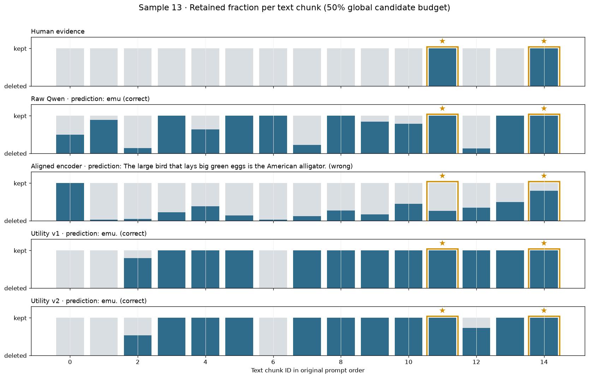
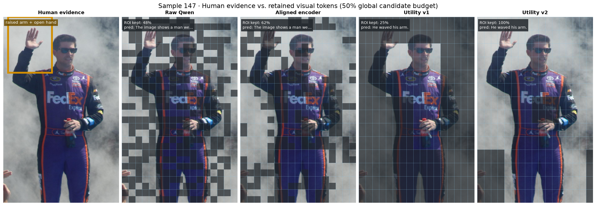

# 多模态长上下文联合 Token Pruning：阶段性研究进展

## 1. 问题、课题与 Idea 简述

本课题研究长多模态上下文中的视觉—文本联合 token pruning。与传统视觉 token pruning 不同，目标场景中的文本与视觉信息共同占用 LLM 上下文和计算预算，而且两种模态之间可能互补、重复或相互依赖。因此，核心问题不是分别对文本和视觉做两个独立的 top-$k$，而是在统一总预算下，根据当前问题和样本内容动态决定：

- 文本和视觉各保留多少 token；
- 每种模态中保留哪些证据；
- 如何在减少 LLM prefill 开销的同时，尽可能保持回答质量。

当前实验以 Qwen2.5-VL-7B-Instruct 和 MMCoQA 为验证环境，在 visual projector 之后、LLM prefill 之前执行 pruning。系统提示、当前问题、特殊 token 和模态边界始终受到保护，仅剪枝历史文本与视觉 token。

## 2. 目前尝试的技术方案 Overview

目前完成了四代主要方案，整体演进路线是：

```text
问题相关性
  Raw Qwen embedding similarity（实验 002）
        ↓ 修复图文分数尺度不一致
  External aligned encoder（实验 003）
        ↓ 从“相关”改为直接学习“删除后有多大损失”
  Learned utility scorer（实验 004）
        ↓ 更贴近批量剪枝，并补充局部图文相似度
  Aligned prefilter + conditional utility（实验 005）
```

- **实验 002：Raw Qwen Joint。** 直接利用 Qwen 输入空间中候选 token 与问题 token 的相似度，为文本和视觉 chunk 打分，再动态分配两种模态的预算。它不需要训练，成本低，但图文 embedding 的尺度不同，预算容易偏向文本。
- **实验 003：Aligned Encoder Joint。** 引入冻结的图文对齐 encoder，在公共图文空间中计算问题与文本窗口、视觉 patch 的相似度，并用分模态经验 CDF 校准到可比较尺度。它解决了“图文分数不能直接比较”，但没有解决“与问题相关是否就等于删除后有损失”。
- **实验 004：Learned Utility v1。** 不再手工假设 similarity 就是重要性，而是用 teacher model 计算 leave-one-chunk-out utility：删除一个 chunk 后，gold answer 的 NLL 上升多少。随后训练轻量 MLP 从 chunk、问题和结构特征预测 utility，用预测值完成 pruning。
- **实验 005：Learned Utility v2。** 先用 aligned encoder 做保守初筛，再在已经删除一部分内容的状态下生成 conditional utility 标签并训练 scorer；同时加入 chunk 内局部 aligned-similarity 特征，边界 chunk 内也改用 aligned score 选择 token。该版本希望同时缓解冗余 chunk、局部稀疏证据和图文尺度问题。

## 3. 各方案下游结果汇总

下表统一使用实验 003–005 共用的固定 50 个 test 样本，报告 MMCoQA Accuracy。实验 002 的路线以同一 test 上重跑的 `Raw Qwen Joint` 表示，从而保证样本、模型、解码与总预算一致。`±` 表示三个 seed 的标准差；No Pruning Accuracy 为 70.0%。


| 方案                                      | 对应实验 | 75% retention | 50% retention |     25% retention |
| ----------------------------------------- | -------: | ------------: | ------------: | ----------------: |
| Random Joint                              | Baseline | 64.0% ± 3.3% | 62.7% ± 4.1% |     47.3% ± 0.9% |
| Raw Qwen Joint                            |      002 |     **66.0%** |     **66.0%** |             46.0% |
| Aligned-only                              |      003 |         62.0% |         48.0% |             48.0% |
| Learned Utility v1                        |      004 | 64.7% ± 2.5% | 60.0% ± 1.6% |     47.3% ± 2.5% |
| Learned Utility v2，prefilter$alpha=0.25$ |      005 | 56.0% ± 1.6% | 58.7% ± 1.9% | **54.7% ± 0.9%** |
| Learned Utility v2，prefilter$alpha=0.50$ |      005 | 58.7% ± 0.9% | 58.0% ± 0.0% |     52.7% ± 6.8% |

目前可以支持的结论是：

- Raw Qwen 是当前 75% 和 50% 预算下最强且最简单的确定性方案，但没有稳定超过 No Pruning。
- Aligned-only 解决了跨模态分数可比性，却没有带来更好的答案保留；50% 下仅为 48%。
- Utility v1 学到了非平凡信号，但 50% 下低于 Raw Qwen 和 Random，25% 下与 Random 持平。
- Utility v2 在 75% 和 50% 下没有改善；在最激进的 25% 预算下，$alpha=0.25$ 三个 seed 均达到 54%–56%，相对 Raw Qwen、Random 和 v1 呈一致正向趋势，但 50 个 test 样本上的配对检验尚不显著。
- 现阶段没有一个方案在三个预算上稳定胜出，因此不能将任一方法表述为已经验证成功。

## 4. 各方案具体技术路线

### 4.1 共通框架

四个方案使用相同的 pruning 位置和预算口径：

1. 将历史文本按语义边界划分为 16–64 token 的 text chunk，将每张图的 projector token 网格划分为空间相邻的 vision chunk。
2. 根据总 retention 计算统一的候选 token 预算，文本与视觉共同竞争该预算。
3. 为 chunk 或 token 计算问题条件分数，据此决定模态预算和模态内部保留顺序。
4. 若预算边界落在 chunk 内，只从该 chunk 中保留部分 token，以严格满足总预算。
5. 按原始顺序重建压缩后的多模态序列，保留原始 mRoPE 位置，再交给冻结的 Qwen 完成正常推理。

后续方案只改变“什么分数代表 chunk 的价值”以及“如何处理边界 chunk”，不改变上述统一实验接口。

### 4.2 实验 002：Raw Qwen Joint

实验 002 使用 Qwen 自身的输入表示。对每个候选 token，计算其与所有问题 token 的最大余弦相似度；一个 chunk 的价值取其中最高 20% token 分数的均值，避免大部分无关 token 稀释少量有效信息。每种模态再聚合最高 20% chunk，得到文本和视觉的整体价值，通过 softmax 动态分配两种模态的预算。

模态内部按照 chunk value 排序保留；最后一个跨越预算边界的 chunk，则按同一套 Raw Qwen token similarity 选择其中分数最高的 token。该方法完全 training-free，核心假设是：Qwen 输入空间中与问题越相似的内容越值得保留。

### 4.3 实验 003：External Aligned Encoder

实验 003 保留实验 002 的 chunk、统一预算和重建框架，只替换打分空间：

- 文本被滑动窗口编码，并将窗口—问题相似度映射回 Qwen text token；
- 图片由 external aligned encoder 产生 dense feature map，与问题向量比较后映射回 Qwen vision token 网格；
- 文本和视觉 raw cosine 分别经过独立 calibration set 上拟合的经验 CDF，转化为各自模态内的 percentile，使两种模态进入近似可比的 $[0,1]$ 尺度；
- 校准后的 token/chunk score 同时用于模态预算与模态内部排序。

这一方案的目的不是训练新模型，而是检验：专门做过图文对齐的公共空间，能否比 Qwen 原始 embedding 更准确地找到与问题相关的文本和图像区域。

### 4.4 实验 004：Learned Utility Scorer v1

实验 004 将重要性定义从“与问题相似”改为“删除后是否损害正确答案”。对每个训练样本，先在完整上下文上计算 gold answer 的 teacher-forced NLL，再分别删除一个 chunk 重算 NLL：

$$
u_g=\operatorname{NLL}(y\mid S\setminus\{g\},q)-\operatorname{NLL}(y\mid S,q).
$$

$u_g$ 越大，说明删除 chunk $g$ 对回答越有害。该 utility 作为监督标签；推理时不需要答案，也不再调用 teacher model，而是由训练好的轻量 scorer 预测 $\hat u_g$。

Scorer 输入包括冻结 Qwen 的 chunk pooled representation、问题表示、两者的点积与差值、chunk 长度/位置、模态 embedding 等特征。训练同时使用 utility 数值回归和 pairwise ranking loss，使模型不仅拟合数值，还学习同一样本内 chunk 的相对顺序。推理阶段根据预测 utility 选择 chunk；边界 chunk 内仍使用 Raw Qwen similarity 选择 token。

### 4.5 实验 005：Aligned Prefilter + Conditional Utility v2

实验 005 将一次 pruning 拆成两阶段。

**第一阶段：Aligned prefilter。** 使用实验 003 的 calibrated aligned score 先删除最终待删预算的一部分。该阶段只负责排除看起来最无关的内容，目标是缩小后续候选集合，而不是直接完成全部 pruning。

**第二阶段：Conditional utility。** 在初筛后的真实剩余集合 $S$ 上，重新计算删除单个 chunk 的条件效用：

$$
u(g\mid S)=\operatorname{NLL}(y\mid S\setminus\{g\},q)-\operatorname{NLL}(y\mid S,q).
$$

相比 v1，这至少让监督信号感知“已经删除一部分内容”的状态。Scorer 除 v1 的 Qwen 表示和结构特征外，还加入 chunk 内 aligned similarity 的 max、mean、std 和 top-fraction mean，试图保留只有少量 token/patch 很关键的局部证据；训练 pair 数从每类每样本 256 提高到 512，并混合高 utility-gap pair 与随机 pair。

推理时先执行相同的 frozen aligned prefilter，再用 conditional utility scorer 对剩余 chunk 排序。第二阶段直接按预测 utility 保留 chunk，不再除以 chunk 长度；所有边界 chunk 内 token 选择也改用 aligned similarity，而不是 Raw Qwen similarity。

## 5. 各方案纰漏分析

### 5.1 实验 002：Raw Qwen Joint

1. **图文分数尺度不可比。** 文本 token 与问题来自同一 embedding table，重复词可以产生接近 1 的相似度；视觉 projector embedding 的分布完全不同。结果是动态预算严重偏向文本，大量样本近似退化为 visual-only。
   - **后续处理：** 实验 003 引入公共图文空间和分模态 CDF calibration，成功修复了数值尺度问题。
2. **词面/语义相关性不等于回答效用。** 与问题相似的 chunk 可能只是复述问题，真正答案证据反而没有高词面重合。
   - **后续处理：** 实验 004 改为直接学习删除 chunk 后的答案 NLL 变化。
3. **静态表示缺少上下文交互。** 同一条证据在其他证据存在或不存在时可能价值不同，单次 similarity 无法表达替代和互补关系。
   - **后续处理：** v1 引入 teacher-derived utility，v2 进一步改为初筛状态下的 conditional utility；但高阶交互仍未完全解决。

### 5.2 实验 003：External Aligned Encoder

1. **解决了“可比较”，没有解决“有用”。** CDF 后图文分数分布接近，但 Aligned-only 的下游 Accuracy 在 75%/50%/25% 下仅为 62%/48%/48%，低于 Raw Qwen 的 66%/66%/46%。这说明 semantic relevance 与 deletion utility 不是同一个目标。
   - **后续处理：** 实验 004 不再让 aligned score 独立决定所有 chunk；实验 005 将它降级为初筛、局部特征和边界 token scorer。
2. **Dense视觉对齐不够可靠。** External encoder 更擅长全图图文匹配，不一定具有细粒度 patch grounding 能力；映射回 Qwen 网格后还可能出现空间误差。
   - **后续处理：** v2 使用 chunk 内 top-fraction 等统计减轻均值稀释，但 Vision–Vision 排序仍未改善。
3. **校准可能消除了有用的数据偏置。** Uncalibrated 在部分预算上反而优于 calibrated，说明“分配更平衡”不等于“任务性能更好”。

### 5.3 实验 004：Learned Utility v1

1. **Leave-one-out 标签与批量 pruning 目标错位。** $u_g$ 描述“其他 chunk 都在时，只删一个 chunk”的边际损失；推理却会一次删除大量 chunk。两个互相替代的 chunk 单独删除时 utility 都可能很低，最后却被同时删掉。
   - **后续处理：** v2 先删除一部分内容，再计算 conditional utility，使标签至少感知一个更接近推理阶段的状态；但它仍是单 chunk 边际量，尚不能表达任意 chunk 子集的联合效用。
2. **均值池化会稀释局部稀疏证据。** 一个视觉 chunk 中可能只有一两个 patch 包含答案，其余都是背景；mean-pooled Qwen feature 很难保留这种信号。
   - **后续处理：** v2 加入 aligned similarity 的 max、std 与 top-fraction mean。
3. **视觉训练信号弱且类别极不平衡。** 视觉 chunk 数远多于文本，但 Vision–Vision utility gap 普遍较小，许多 pair 的学习价值有限。v1 最多采样 256 个 pair，也可能错过真正有区分度的视觉 pair。
   - **后续处理：** v2 提高到 512 个 pair，并按一半高 gap、一半随机采样；结果仍显示 Vision–Vision pairwise accuracy 接近随机。
4. **边界 chunk 内仍依赖 Raw Qwen similarity。** 即使 chunk 排序正确，最后部分保留时仍可能删掉 chunk 内的关键 patch。
   - **后续处理：** v2 改用 aligned token score。
5. **Scorer 很早过拟合。** Train loss 持续下降，但 validation 排序提升弱；说明问题更可能在标签、特征与目标错位，而不是 MLP 容量或训练轮数不足。

### 5.4 实验 005：Conditional Utility v2

1. **初筛不可逆，且高-utility recall 没有优于随机期望。** 一旦 aligned prefilter 删除真正关键的 chunk，第二阶段 scorer 再强也无法恢复。当前结果没有支持“aligned relevance 能安全排除无关证据”的核心假设。
2. **Conditional label 改变了监督目标，但尚未证明变得更正确。** 它与 v1 LOO 排名相关较低，说明状态确实产生影响；但目前缺少 Conditional Oracle，无法判断变化来自有价值的交互信息，还是 teacher-forced NLL 噪声。
3. **视觉内部排序仍近似随机。** 三个 seed 的 Vision–Vision pairwise accuracy 约为 51%，整体 Spearman 约为 0.07。增加 aligned statistics、状态特征和更多 pair，没有解决占候选多数的视觉细粒度排序。
4. **没有统一最优的初筛比例。** 75% 偏向 $\alpha=0.50$，50%/25% 偏向 $\alpha=0.25$；这些都是 test 后观察，不能反向作为无偏调参依据。25%、$\alpha=0.50$ 的 seed Accuracy 从 46% 到 62%，也暴露出较强不稳定性。
5. **现有 Accuracy 存在语义 false negative。** 指标主要依赖归一化后的 gold substring matching，不能识别 `waving` 与 `waved` 等词形等价。该问题会影响所有方案，但不同 pruning 上下文会改变回答长短和措辞，因此影响不一定完全对称。

### 5.5 Case 可视化：局部成功不等于总体方法已成立

下面两张图统一比较 Human-identified evidence、Raw Qwen、Aligned encoder、Utility v1 和 Utility v2 在 50% 总预算下的保留策略。人工证据用于解释 case，不被视为唯一 ground truth。

#### 文本 Case：sample 13

问题询问哪种大型鸟会产绿色的大蛋，人工定位的关键证据位于 chunk 11 和 14。Raw Qwen、Utility v1 和 Utility v2 均完整保留两个 chunk，并回答 `emu`；Aligned 只保留 chunk 11 的 26.6% 和 chunk 14 的 80.0%，最终错误回答 `American alligator`。



这个样本说明 Utility 的确能学到有意义的选择行为，但它是按“问题简单、证据清晰、方法有差异”的标准挑出的解释性 case，不能代表 50 个 test 样本的总体分布。

#### 视觉 Case：sample 147

问题询问人物对手臂做了什么，图片中人物明显正在挥手。Raw Qwen、Aligned、Utility v1、Utility v2 对人工手臂/手掌 ROI 的保留率分别为 47.9%、62.5%、25.0% 和 100.0%。



Utility v2 在这个 case 中完整保留关键区域；但 Utility v1 只保留 25% ROI 仍输出 `He waved his arm.`，Aligned 保留 62.5% ROI 却没有识别动作。这说明 evidence retention 不是 answer correctness 的充分条件，视觉理解和生成本身也会影响结果。更重要的是，Utility v1/v2 的 `He waved his arm.` 在语义上正确，却被当前自动指标判为错误，直接暴露了评测 false negative。

综合两张图，当前更准确的判断是：**Utility 已经在部分样本上展现出比 similarity selector 更合理的证据选择能力，v2 也能产生非常理想的局部区域保留；但这种能力尚不稳定，尤其没有覆盖大量视觉 chunk 的内部排序，因此总体 Accuracy 仍未超过简单基线。**

## 6. 下一步

1. 暂定和学长沟通后再说

---

主要证据来源：`docs/experiments/002_chunk_based_joint_pruning.md`、`003_aligned_encoder_scoring.md`、`004_learned_utility_scorer.md`、`005_learned_utility_scorer_v2.md`，以及 `notebooks/viz.ipynb`。本文主结果表优先采用实验 003–005 共用固定 test 上的可比结果。
