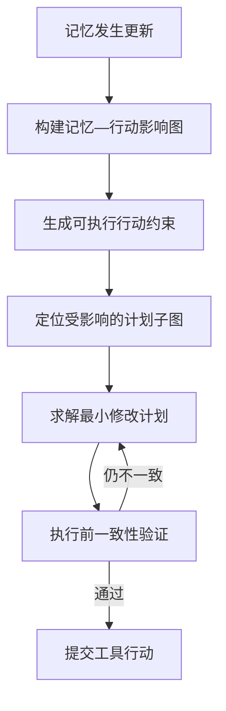

# 前言

## Agent 综述

[智能体 Agent](智能体 Agent)

## 目标会议


| 大致顺序 | 会议                 |            Agent 相关性 | 官网                                                                                   | 投稿截止日期                                  | 当前状态 / 备注                                                                                                                                                                                                                                                                                                       |
| -------- | -------------------- | ----------------------: | -------------------------------------------------------------------------------------- | --------------------------------------------- | --------------------------------------------------------------------------------------------------------------------------------------------------------------------------------------------------------------------------------------------------------------------------------------------------------------------- |
| 1        | **ACL 2027**         |              ⭐⭐⭐⭐⭐ | [ACL 2027](https://2027.aclweb.org/?utm_source=chatgpt.com)                            | **2027-01-04**ARR deadline                    | **非常推荐**。CFP 已直接列出**LLM Agents for NLP**，Agent benchmark、reasoning、tool use、memory 等都很合适 ([ACL会员门户](https://www.aclweb.org/portal/content/acl-2027-first-call-papers?utm_source=chatgpt.com "ACL 2027: First Call for Papers                                                                   |
| 2        | **IJCAI 2027**       |              ⭐⭐⭐⭐⭐ | [IJCAI 2027](https://2027.ijcai.org/?utm_source=chatgpt.com)                           | Abstract:**2027-01-04**；Paper:**2027-01-11** | **非常推荐**，综合 AI 顶会，Agent / planning / reasoning / multi-agent 都很正统 ([2027.ijcai.org](https://2027.ijcai.org/?utm_source=chatgpt.com "IJCAI 2027"))                                                                                                                                                       |
| 3        | **ISSTA 2027**       | ⭐⭐⭐⭐☆ Coding Agent | [ISSTA 2027](https://conf.researchr.org/home/issta-2027?utm_source=chatgpt.com)        | Abstract:**2027-01-08**；Paper:**2027-01-11** | 如果做**Coding Agent、软件测试 Agent、Agent debugging/evaluation**，非常值得考虑 ([Researchr](https://conf.researchr.org/home/issta-2027?utm_source=chatgpt.com "ISSTA 2027"))                                                                                                                                        |
| 4        | **ICML 2027**        |              ⭐⭐⭐⭐⭐ | [ICML 官网](https://icml.cc/?utm_source=chatgpt.com)                                   | **TBA**，预计 2027 年 1–2 月                 | Agent learning、RL、reasoning、test-time learning、Agent 方法论特别合适；官网目前只公布 2027 在南美举办，deadline 尚未公布 ([国际机器学习大会](https://icml.cc/Conferences/FutureMeetings?utm_source=chatgpt.com "Conferences Future Meetings"))                                                                      |
| 5        | **COLM 2027**        |              ⭐⭐⭐⭐⭐ | [COLM 官网](https://colmweb.org/?utm_source=chatgpt.com)                               | **TBA**，预计 2027 年 3 月左右                | LLM/Agent 特别对口；2026 full paper 是 3 月 31 日，因此可先把**3 月底**当内部目标，但这不是官方 2027 deadline ([GitHub](https://github.com/COLM-org/colm-org.github.io/blob/main/cfp.md?utm_source=chatgpt.com "colm-org.github.io/cfp.md at main · COLM-org/colm-org.github.io · GitHub"))                         |
| 6        | **NeurIPS 2027**     |              ⭐⭐⭐⭐⭐ | [NeurIPS 官网](https://neurips.cc/?utm_source=chatgpt.com)                             | **TBA**，预计 2027 年 5 月                    | Agent learning、reasoning、RL、scaling、evaluation 都适合；目前只确认 2027 在欧洲举办 ([neurips.cc](https://neurips.cc/Conferences/FutureMeetings?utm_source=chatgpt.com "Conferences Future Meetings"))                                                                                                              |
| 7        | **EMNLP 2027**       |              ⭐⭐⭐⭐⭐ | [ACL Anthology / EMNLP 系列](https://aclweb.org/?utm_source=chatgpt.com)               | **TBA**，预计 2027 年春夏 ARR cycle           | LLM Agent / NLP Agent 非常合适；2027 正式 CFP 尚未公布                                                                                                                                                                                                                                                                |
| 8        | **KDD 2027 Cycle 2** |              ⭐⭐⭐☆☆ | [KDD 2027](https://kdd2027.kdd.org/?utm_source=chatgpt.com)                            | **TBA**                                       | 如果是 Agent benchmark、data agent、recommender agent、real-world agent system 较合适。KDD 官方确认有两个投稿 cycle，但目前公布的只是 Cycle 1，已于 2026-07-26 截止 ([kdd2027.kdd.org](https://kdd2027.kdd.org/research-track-call-for-papers/?utm_source=chatgpt.com "Research Track: Call for Papers – KDD 2027")) |
| 9        | **AAAI 2028**        |              ⭐⭐⭐⭐⭐ | [AAAI](https://aaai.org/conference/aaai/?utm_source=chatgpt.com)                       | **TBA**，预计 2027 年 7 月左右                | Agent / reasoning / planning / MAS 都非常合适；AAAI 2027 已于**2026-07-28**截止 ([AAAI](https://aaai.org/conference/aaai/aaai-27/submission-instructions/?utm_source=chatgpt.com "AAAI-27 Submission Instructions - AAAI"))                                                                                           |
| 10       | **ICLR 2028**        |              ⭐⭐⭐⭐⭐ | [ICLR](https://iclr.cc/?utm_source=chatgpt.com)                                        | **TBA**，预计 2027 年 9 月                    | Agent learning、reasoning、RL、Agent architecture 非常适合；ICLR 2027 已于**2026-09-25**截止 ([ICLR](https://iclr.cc/Conferences/2027/Dates?utm_source=chatgpt.com "2027 Dates and Deadlines"))                                                                                                                       |
| 11       | **AAMAS 2028**       |   ⭐⭐⭐⭐⭐ Agent 本家 | [AAMAS 2027 官网](https://warwick.ac.uk/fac/sci/dcs/aamas2027/?utm_source=chatgpt.com) | **TBA**，预计 2027 年 10 月                   | **Autonomous Agents and Multiagent Systems 本家会议**；2027 已于 2026-10-08 截止，CFP 明确包括 generative / agentic AI ([Google 群组](https://groups.google.com/a/aixia.it/g/aixia/c/kZds9Ii1DE0?utm_source=chatgpt.com "AAMAS 2027: First Call for Papers"))                                                         |

# 问题确立与初步 idea

## 候选问题


| 推荐顺序 | 方向               | 问题                                                   | 一句话解释                                                           | 主要价值／应用场景                                             | 当前研究状态                                                                  | 推荐度     |
| -------: | ------------------ | ------------------------------------------------------ | -------------------------------------------------------------------- | -------------------------------------------------------------- | ----------------------------------------------------------------------------- | ---------- |
|        1 | 记忆／上下文管理   | **记忆更新后，行为没有同步更新**                       | Agent 明明知道旧信息已经失效，规划和行动时却仍受旧信息影响           | 长期助手、日程规划、医疗管理、个性化 Agent、企业规则执行       | 问题已被初步揭示，但“记忆变化如何传播到所有下游行为”仍未解决                | ★★★★★ |
|        2 | 预算分配与效率     | **共享总预算下，多个任务之间如何动态分配资源**         | 不只考虑一个任务怎么花预算，而是决定哪些任务值得继续投入、暂停或放弃 | 企业 Agent 平台、批量科研 Agent、云端服务、多用户 coding agent | 现有研究多聚焦单任务预算；跨任务、在线、动态资源竞争仍较空缺                  | ★★★★★ |
|        3 | 验证与错误恢复     | **执行 Agent 与验证器存在相同盲区**                    | 多个模型都同意，不一定正确，可能只是以相同方式犯错                   | 代码、科研、数据分析、财务、法务等高可靠 Agent                 | 已发现“共识也可能掩盖错误”，但验证器相关性与证据独立性仍未充分研究          | ★★★★★ |
|        4 | 持续学习与技能迁移 | **环境变化后，旧技能会悄悄失效**                       | 工具、网页或 API 改变后，旧技能可能不报错，却产生错误行为            | Web Agent、GUI Agent、coding agent、企业 API、机器人           | 已有技能漂移和版本管理工作，但“使用前识别技能已失效”仍缺少成熟方案          | ★★★★★ |
|        5 | 持续学习与技能迁移 | **学习效果高度依赖经历顺序**                           | Agent 按 A→B→C 学习与按 C→A→B 学习，最终能力可能不同             | 自我进化 Agent、机器人、游戏 Agent、自动科研 Agent             | 已有 benchmark 证明路径依赖存在，但如何主动规划最优学习顺序仍较空缺           | ★★★★☆ |
|        6 | 记忆／上下文管理   | **现有 benchmark 没有真正测出记忆是否有用**            | 很多评测只测“能否回忆”，没有测记忆是否真正改善后续行动             | Agent memory 评测、长期交互、个性化系统                        | 已有人指出评测失真，但反事实、行动级、成本感知评测仍不成熟                    | ★★★★☆ |
|        7 | 验证与错误恢复     | **Agent 难以发现自己遗漏了要求**                       | 已经完成的内容可能都正确，但任务要求中的某些部分根本没做             | 报告生成、代码修改、旅行规划、科研调研、企业流程               | 已有工作开始检查遗漏，但开放任务中的完整需求覆盖仍未解决                      | ★★★★☆ |
|        8 | 持续学习与技能迁移 | **技能迁移会产生负迁移，Agent 不知道何时不该使用技能** | 历史任务与当前任务表面相似，但关键条件不同，使用旧技能反而降低表现   | Web、GUI、编程、跨任务经验复用                                 | 已确认负迁移普遍存在；技能适用边界和可靠拒用机制仍有空间                      | ★★★★☆ |
|        9 | 预算分配与效率     | **现有预算计量过于简单**                               | 只统计 token 和工具次数，没有同时考虑延迟、风险、人工审批和失败损失  | 真实生产 Agent、企业自动化、高风险操作                         | 多目标成本建模已有不少工作，仍有价值，但需要绑定具体场景才能形成创新          | ★★★☆☆ |
|       10 | 预算分配与效率     | **Agent 不知道继续投入预算还有没有希望**               | Agent 可能在不可能成功的路径上持续搜索、重试和反思                   | 搜索 Agent、coding agent、长程工具 Agent                       | early stopping 和可恢复性估计已较拥挤，需要更强的校准或跨环境泛化贡献         | ★★★☆☆ |
|       11 | 记忆／上下文管理   | **删除记忆不等于信息影响真正消失**                     | 原始记录删除后，信息仍可能存在于摘要、画像、图片、技能或派生结论中   | 私人助手、医疗、企业知识库、多用户 Agent                       | 价值极高，但 Agent unlearning、隐私和 provenance 已成为热门研究线，撞题风险高 | ★★★☆☆ |
|       12 | 验证与错误恢复     | **恢复后，Agent 内部成功但外部世界仍然不一致**         | 回滚自身状态后，外部订单、邮件或支付可能已经执行，导致重复操作       | 支付、订票、企业流程、跨平台自动化                             | rollback、补偿操作、幂等调用和非原子失败已有大量直接工作                      | ★★☆☆☆ |

## idea 定位

**Evolving Memory 下多步工具 Agent 的行动级策略一致性**

### Problem

现有 Agent 能正确更新和检索用户状态，但仍可能在多步工具执行中调用依赖旧状态的动作。

例如，用户从北京搬到上海后，Agent 的最终回答可能已经提到上海，但搜索机票时仍把北京填为出发地。也就是说：

> 记忆更新正确，不代表后续计划和工具操作也同步更新。

现有研究主要在自然语言回答层面评测这一问题，我们希望进一步研究：**在多步工具执行中，Agent 能否让所有相关行动真正适应最新记忆。**

### Evaluation

除了必跑 Benchmark 外，有余力可以考虑如下这种指标：

使用反事实配对环境，分别测量：

* 应改变行为的 sensitivity；
* 不应改变行为的 invariance；
* 多步工具轨迹中的 stale-action rate。

具体展开而言，

对同一个任务构造两个配对世界：

**W\_{\\text{old}},\\quad W\_{\\text{new}}**

二者唯一差异是某条记忆状态。

例如：


| 条件      | 出发城市 | 其他信息 |
| --------- | -------- | -------- |
| Old world | 北京     | 完全相同 |
| New world | 上海     | 完全相同 |

让同一个 Agent 在共同随机条件下分别执行。

检查：

1. 应该改变的行动是否改变；
2. 不应改变的行动是否保持不变；
3. 最终环境是否符合对应状态。

可以定义两个互补指标：

**\\text{Sensitivity} = P(\\text{依赖更新的行为正确改变})**

**\\text{Invariance} = P(\\text{不相关行为保持稳定})**

优秀系统必须同时做到：

* 对相关变化敏感；
* 对无关部分稳定。

否则可能出现“为了适应更新，把所有计划全部重做”的过度反应。

### Method

#### 1. Memory-to-Action Influence Modeling

不能只保存“当前有效状态”，还要建模：

> 哪些计划、工具调用和中间结果依赖这条记忆？

例如：

```
用户搬到上海
├── 影响：机票出发城市
├── 影响：天气查询位置
├── 影响：酒店搜索范围
└── 不影响：靠窗偏好、酒店安静偏好
```

可以将完整关系表示为一个动态影响图：

**G=(M,C,P,A)**

其中：

* **M**：记忆或状态；
* **C**：由状态产生的任务约束；
* **P**：计划步骤；
* **A**：实际工具动作。

边表示依赖关系：

**M\_i \\rightarrow C\_j \\rightarrow P\_k \\rightarrow A\_l**

记忆 **M\_i** 更新后，沿图找到真正受影响的子图，而不是重新生成全部计划。

这里的研究难点是：

* 依赖关系通常没有显式写出来；
* 一条记忆可能间接影响多个步骤；
* 表面相关不代表真正影响行为；
* 同一行动可能同时由多条记忆支持。

所以它不能只是一个普通知识图谱，而应当专门描述“记忆如何影响行动”。

---

#### 2. State-to-Action Contract Generation

checker 不应该依靠人工提前写规则，而要让系统自动把自然语言记忆转化为可执行约束。

例如：

```
用户：我已经搬到上海了，而且最近预算比较紧，
这次旅行最多花2000元。
```

自动生成：

```
constraints:
  - search_flight.origin == "Shanghai"
  - total_cost <= 2000
  - previous_residence != default_departure_city
```

这里可以把约束分成不同类型：


| 类型       | 例子                           |
| ---------- | ------------------------------ |
| 硬约束     | 总费用不能超过2000元           |
| 软偏好     | 优先选择靠窗座位               |
| 时效约束   | 该状态从10月开始有效           |
| 作用域约束 | 只适用于本次旅行               |
| 条件约束   | 如果用户乘飞机，则优先虹桥机场 |
| 不确定约束 | 用户“可能”搬到上海，需要确认 |

这样，方法就不再只是“检查工具调用”，而是完成：

**\\text{Natural-Language Update} \\rightarrow \\text{Executable Behavioral Contract}**

可以进一步研究：

* 什么时候自动采用更新；
* 什么时候需要查询外部环境；
* 什么时候应该向用户确认；
* 不同约束冲突时如何确定优先级。

---

#### 3. Dependency-Aware Minimal Replanning

发现某个行动违反新状态后，不是重新生成全部计划，而是求一个“最小修改”的新计划。

可以形式化为：

**P^\* = \\arg\\min\_{P'} \\Big[ \\underbrace{D(P',P)}\_{\\text{计划修改量}} + \\lambda\\underbrace{V(P',S\_{\\text{new}})}\_{\\text{违反新状态的程度}} + \\mu\\underbrace{C(P')}\_{\\text{重新执行成本}} \\Big]**

其中：

* **P**：原计划；
* **P'**：修复后的计划；
* **D(P',P)**：修改了多少原计划；
* **V(P',S\_{\\text{new}})**：是否仍违反最新状态；
* **C(P')**：重新调用模型和工具的成本。

直观目标是：

> 在完全符合新状态的前提下，尽可能少改步骤、少重复调用工具、少破坏已经正确完成的工作。

例如原计划：

1. 从北京搜索机票；
2. 筛选靠窗座位；
3. 预订上海酒店；
4. 检查总预算。

用户更新为“从上海出发”后，只需要重做：

1. 搜索上海出发的机票；
2. 基于新航班重新筛选座位；
3. 酒店结果可能继续保留；
4. 重新计算总预算。

这比简单地“重新让 Agent 做一遍”更有研究价值。

#### 完整闭环



## 现有相关工作

### 1. STALE：正式定义问题

STALE 将动态记忆能力拆成三个层次：


| 层次                       | 要回答的问题                                 |
| -------------------------- | -------------------------------------------- |
| State Resolution           | Agent 知不知道当前状态是什么                 |
| Premise Resistance         | 用户的问题包含旧前提时，Agent 能否拒绝旧前提 |
| Implicit Policy Adaptation | 用户不提醒时，Agent 能否主动让行为适应新状态 |

例如：

* 旧记忆：用户每天骑自行车上班；
* 新事实：用户腿骨折；
* 当前请求：帮我规划明天的通勤。

第三个层次要求 Agent 主动意识到“骑车通勤现在不适用”，即使用户没有显式说“我不能骑车”。

STALE 包含 400 个场景、1200 个测试问题；最佳受测系统总体准确率仍只有 55.2%。[arxiv.org](https://arxiv.org/html/2605.06527v1?utm_source=chatgpt.com)

### 2. CUPMem：在写入阶段传播更新

CUPMem 的基本方向是：

* 对状态进行结构化整理；
* 识别新旧状态；
* 搜索可能受更新影响的相关记忆；
* 在写入阶段进行合并和传播。

它说明“传播式更新”是可行方向，但仍然不能保证行为一定改变。

### 3. StateAuditor：在回答阶段反向审计

StateAuditor 发现：

* STALE 的写入侧方法状态识别准确率可达到约 91%；
* 但 IPA 只有约 32%；
* 大量失败案例里，最新信息已经出现在上下文中。

所以问题不是“没找到最新信息”，而是模型没有真正按照它行动。

StateAuditor 不从回答中寻找显式错误，而是：

1. 从记忆中找到 old→new transition；
2. 生成回答草稿；
3. 从状态更新反向检查草稿是否仍受旧状态影响；
4. 发现问题后重新生成。

它在 STALE 上带来约 5 个百分点提升，但在更困难的生命周期数据上没有稳定增益，并明确不声称已经解决通用 Agent memory。[arxiv.org](https://arxiv.org/abs/2608.01619?utm_source=chatgpt.com)

### 4. StateMem：显式追踪当前有效状态

StateMem 将：

* 事实；
* 规则；
* 派生量；
* supersession；
* relational dependency

显式表示出来。

它处理了 status、salience、sequence、compound 和 anti-trap 等不同状态错误，但主要评测仍然是对当前状态的回答，而不是完整的多步工具执行。[arxiv.org](https://arxiv.org/html/2608.19652v1?utm_source=chatgpt.com)

### 5. 其他非常接近的工作


| 工作                        | 已经覆盖什么                               | 仍然留下什么                                       |
| --------------------------- | ------------------------------------------ | -------------------------------------------------- |
| TEPA                        | 使旧记忆显式失活，防止继续检索             | 主要解决记忆污染，不保证复杂行为同步               |
| TRACE                       | 多 Agent 暂离、返回后的记忆准入            | 聚焦返回场景，不是一般多步工具策略                 |
| MemoryArena                 | 记忆如何支持跨 session 的环境任务          | 更新通常是任务附带产生，不专门控制 IPA             |
| WorldMemArena               | 多模态记忆的写入、维护、检索和使用         | 是广义评测，不专门隔离 stale-memory policy failure |
| Memory Commitment Benchmark | 判断应该记住、验证还是询问，并测试工具选择 | 主要关注写入承诺和澄清边界                         |
| Dependency-Guided Rollback  | 错误记忆造成失败后，沿依赖图修复           | 属于事后恢复，不是更新后的主动行为适应             |

这意味着我们要避开：

* 单纯设计新的 old/new 状态表；
* 单纯做 dependency graph；
* 单纯在回答后加 auditor；
* 单纯让 Agent 询问用户；
* 单纯撤销旧记忆；
* 单纯做级联失效。

这些都已有直接相邻工作。

---

## 研究意义与 motivation

### 1. 当前记忆研究仍然偏“数据库思维”

很多工作关注：

* 是否保存了信息；
* 是否能检索出来；
* 是否能识别最新版本；
* 是否能删除旧版本。

但 Agent memory 的最终价值不是“记住”，而是：

> 让未来行动变得正确。

如果 Agent 能正确回答“用户住在上海”，却在订票时仍以北京为出发地，那么从实际应用角度看，这套记忆系统仍然失败了。

可以用一句很适合论文引言的话概括：

> Memory correctness is not behavioral correctness.

或者更完整：

> Existing memory systems primarily optimize what an agent stores and retrieves, but real-world utility ultimately depends on whether updated memory changes the agent’s downstream policy and actions.

---

### 2. 现有结果已经证明 retrieval 不是充分条件

StateAuditor 报告：

* 写入侧原型的 state resolution 可以达到约 91%；
* IPA 只有约 32%；
* 67.8% 的 IPA 失败案例中，最新证据已经对生成器可见。

这直接说明：

[ \\text{Update} + \\text{Retrieval} \\neq \\text{Behavioral Adaptation} ]

也就是说，继续优化 embedding、top-(K) 或 reranker，未必能解决问题。[arxiv.org](https://arxiv.org/html/2608.01619v1?utm_source=chatgpt.com)

---

### 3. 错误行为比错误回答代价更高

在普通聊天中，旧信息可能只导致不合适的建议。

在 Agent 系统中，它可能产生：

* 错误工具参数；
* 错误订单；
* 错误日程；
* 错误代码修改；
* 错误文件操作；
* 错误资源分配；
* 违反最新用户约束的自动行动。

语言错误还可以被用户纠正，而工具行动可能已经改变外部状态。

---

### 4. 现有 benchmark 主要仍是 answer-level

虽然 MemoryArena、WorldMemArena 等开始将记忆放入交互环境，但 STALE 和 StateAuditor 对 IPA 的主要评测仍然集中在个性化回答。

StateMemBench 也明确指出：MemoryArena 的更新通常只是任务执行中附带产生，未构造专门的 supersession chain；失败只记作任务失败，不能判断是否具体选择了旧状态。[arxiv.org](https://arxiv.org/html/2608.19652v1?utm_source=chatgpt.com)

因此，一个专门隔离：

* 状态更新；
* 多步工具轨迹；
* stale-dependent action；
* 最终环境状态；

的 benchmark 具有明确研究意义。

---

## 需要考虑的问题

### Q1：这不就是 stale memory 或 conflict resolution 吗？

可以回答：

> 不是。Stale-memory management 主要确保旧记忆被识别、撤销或不再检索。我们的研究假设最新状态已经成功进入工作上下文，关注的是在此条件下，执行策略和工具行动是否仍然依赖旧状态。它研究的是 memory-to-policy interface，而不只是 memory maintenance。

---

### Q2：StateAuditor 已经解决“记忆更新但行为不更新”，你们有什么不同？

可以回答：

> StateAuditor 面向开放式个性化回答，通过状态到草稿的反向审计修复文本响应。我们的研究对象是多步工具执行：旧状态可能影响计划分解、工具选择、参数填写和中间环境修改，最终文本审计无法可靠发现这些错误。我们进一步在 action level 定义一致性，并使用可执行环境状态验证，而不是只依赖回答级 judge。

---

### Q3：直接把最新记忆放进 prompt 不就行了吗？

回答重点：

> STALE 和 StateAuditor 的结果已经表明，最新证据可见仍不保证策略适应。模型可能受到旧状态的显著性、已有计划、隐含前提或早期 commitment 影响。我们针对的是 use failure，而不是 retrieval failure。

---

### Q4：用更强的模型是不是就解决了？

可以回答：

> 更强模型可能降低错误率，但不能提供系统层保证，而且不同模型都存在状态更新后继续沿用旧策略的现象。高风险工具操作不能仅依赖模型“通常能理解”，还需要可测量的行动一致性和执行前约束。

实验上必须测试多个模型族，证明问题不是某一个小模型造成的。

---

### Q5：为什么不直接把所有旧计划全部重做？

可以回答：

> 全量重规划成本高，而且会破坏仍然有效的偏好、约束和已完成工作。正确目标不是最大化行为变化，而是只改变真正依赖更新状态的行为。因此我们同时评估 update sensitivity 和 unaffected-behavior invariance。

---

### Q6：你们是不是只是做了一个 rule-based checker？

可以回答：

> 确定性检查是执行保证的一部分，但研究难点在于从自然语言状态更新中推导出与当前任务相关的行动约束，并在多步轨迹中定位哪些动作依赖该状态。系统结合语义推理、状态表示和可执行验证，而不是依赖固定字段匹配。

不过要让这个回答成立，实验里必须包含：

* 隐含更新；
* 多属性影响；
* 未见过的工具；
* 组合约束；
* 不应更新的 anti-trap case。

---

## 适用场景


| 场景           | 记忆更新                     | 如果行为未同步                    |
| -------------- | ---------------------------- | --------------------------------- |
| 个人日程助手   | 用户工作时间变化             | 仍在新工作时间安排会议            |
| 旅行 Agent     | 出发城市、预算或签证状态变化 | 搜索旧城市航班或超预算下单        |
| 购物 Agent     | 地址、尺码、过敏信息变化     | 寄往旧地址或购买不适合商品        |
| 医疗健康助手   | 病情、药物、禁忌发生变化     | 继续给出基于旧健康状态的建议      |
| 金融 Agent     | 风险偏好、余额、投资目标变化 | 继续执行旧风险级别策略            |
| Coding Agent   | 用户需求或接口发生变化       | 代码说明更新了，实现仍遵循旧需求  |
| 科研 Agent     | 实验假设或数据版本变化       | 继续基于旧假设分析和绘图          |
| 数据分析 Agent | 指标定义或过滤条件变化       | 报告文字更新，SQL 仍使用旧口径    |
| 企业流程 Agent | 组织规则或审批权限变化       | 沿用旧审批流程执行操作            |
| 客服 Agent     | 订单状态、退款规则变化       | 给出或执行已经失效的处理方案      |
| GUI/Web Agent  | 页面状态或用户目标变化       | 按旧页面或旧目标继续点击          |
| 多 Agent 协作  | 其他 Agent 更新共享计划      | 暂离后返回的 Agent 继续执行旧分工 |
| 机器人         | 人的位置、环境和任务约束变化 | 继续执行已经不安全的动作序列      |
| 智能家居       | 用户在家状态或设备状态变化   | 执行与当前环境冲突的自动化        |
| 长期提醒系统   | 未来计划被取消或修改         | 旧提醒、预约或跟进任务继续触发    |
